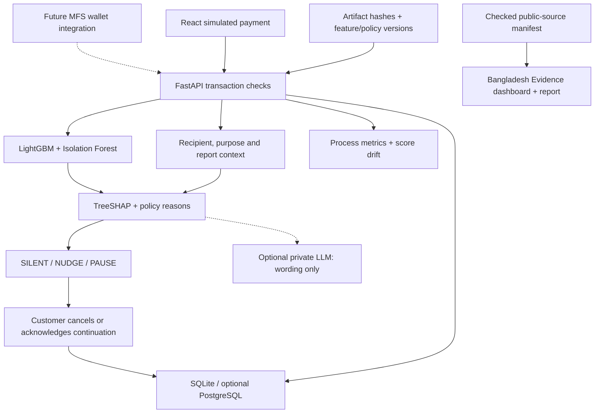

# Prototype and future wallet architecture

Solid connections describe implemented prototype paths. Dotted wallet integration is proposed; dotted LLM is optional. Evidence is a static historical snapshot independent of customer data and model results. Benchmarks are regenerated offline and published as aggregate summaries.

Security boundary: authenticated demo sessions own customer state/checks; admin-key routes own global data exports. These sessions are not real identities. Real provider authentication, payment processing, production model registry, geographic hosting guarantees and banking-grade transaction audit are not implemented.

Frontend routes: `/#evidence`, `/#evaluation`, `/#impact` work with static hosting. `/evidence`, `/evaluation`, `/impact` are supported by Vercel rewrites. Actual public files remain under `/evidence/`. `GET /public-evidence` returns the same checked manifest; existing `GET /evidence` remains synthetic evaluation.
